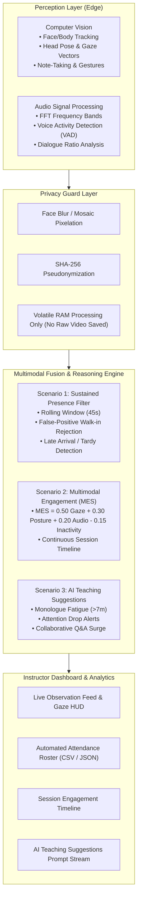

# Multimodal Attendance & Engagement Agent
### AI-Powered, Privacy-Preserving Classroom Intelligence System

> **Designed for 100% Offline Edge Deployment** • Ethical Classroom AI • Real-Time Decision Support for Educators

---

## 📖 Overview

In modern educational institutions and professional training environments, attendance tracking remains largely manual or bound to basic biometric systems that fail to capture meaningful engagement and participation context. These traditional approaches are time-consuming, prone to inaccuracies, and provide zero insight into learner attention, interaction patterns, or session effectiveness.

The **Multimodal Attendance & Engagement Agent** moves beyond simple presence detection by fusing:
1. **Computer Vision**: Participant tracking, head pose (yaw/pitch/roll), gaze direction alignment, note-taking gestures, and inactivity counters.
2. **Audio Signal Processing**: Real-time Fast Fourier Transform (FFT) spectrum analysis, Voice Activity Detection (VAD), and speech-to-silence interaction ratios.
3. **Agent-Based Pedagogical Reasoning**: Real-time context-aware teaching suggestions that alert educators to pacing issues, cognitive fatigue, and collaboration opportunities.
4. **Privacy-Preserving Edge Architecture**: Designed to operate entirely offline without cloud telemetry, storing zero raw video feeds, with real-time face blurring and cryptographic pseudonymization.

---

## 🎯 The Three Core Scenarios



### Scenario 1: Automated Attendance Tracking (Sustained Presence)
- **Problem Solved**: Traditional biometric checkpoints and single-frame snapshot cameras generate false positives whenever visitors, janitors, or hallway passersby momentarily step in front of the lens.
- **The Solution**: Evaluates participant presence over a **sliding temporal window** ($T_{window} = 45\text{s}, \theta_{presence} \ge 65\%$).
- Transitory appearances ($< 15\text{s}$) are automatically flagged as `FILTERED (Transitory Passerby)` and rejected from roll calls.
- Sustained attendees are authenticated with certified duration logs, entry/exit timestamps, and late-arrival classification.

### Scenario 2: Engagement and Session Dynamics Analysis
- **Problem Solved**: Instructors frequently lose track of session pacing and cannot identify when students disengage until grades or exam scores suffer.
- **The Solution**: Continuously evaluates multimodal behavioral indicators:
  $$\text{MES}_i = 0.50 \cdot G_i + 0.30 \cdot P_i + 0.20 \cdot A - 0.15 \cdot I_i$$
  - $G_i$: Gaze vector alignment (derived from 3D head yaw and pitch).
  - $P_i$: Posture stability and active writing/hand-raising movement.
  - $A$: Acoustic dialogue synchrony (matching speech to lecture context).
  - $I_i$: Inactivity penalty (escalating when motionless $> 60\text{s}$).
- Continuous multi-layer canvas timeline plotting the Classroom Attention Index against speech activity.

### Scenario 3: AI-Driven Teaching Suggestions
- **Problem Solved**: Classroom analytics are useless if delivered days later. Instructors need real-time assistive guidance *during* the class.
- **The Solution**: A non-intrusive decision-support agent that diagnoses pedagogical inflection points:
  - *Monologue Fatigue Alert*: Suggests a 60-second "Think-Pair-Share" or rapid concept check after $> 7\text{m}$ of continuous lecture.
  - *Attention Plunge Alert*: Directs the instructor to step toward disengaged seating zones or re-anchor attention with an open-ended question.
  - *Interaction Momentum*: Capitalizes on student questions and hand-raises to transition into peer debate.

---

## 📂 Project Structure & Source Links

You can access and inspect each component directly:

- **Server & Launchers**:
  - [server.js](file:///C:/Users/ASUS/.gemini/antigravity/scratch/multimodal-classroom-agent/server.js) — Zero-dependency Node.js HTTP & REST API server
  - [package.json](file:///C:/Users/ASUS/.gemini/antigravity/scratch/multimodal-classroom-agent/package.json) — Project manifest and scripts
  - [start.bat](file:///C:/Users/ASUS/.gemini/antigravity/scratch/multimodal-classroom-agent/start.bat) — One-click Windows startup batch script

- **Frontend Cockpit (Single Page Application)**:
  - [public/index.html](file:///C:/Users/ASUS/.gemini/antigravity/scratch/multimodal-classroom-agent/public/index.html) — Interactive classroom intelligence cockpit UI
  - [public/css/style.css](file:///C:/Users/ASUS/.gemini/antigravity/scratch/multimodal-classroom-agent/public/css/style.css) — Modern dark glassmorphic design system
  - [public/css/dashboard.css](file:///C:/Users/ASUS/.gemini/antigravity/scratch/multimodal-classroom-agent/public/css/dashboard.css) — HUD gauges, layouts, and components
  - [public/js/app.js](file:///C:/Users/ASUS/.gemini/antigravity/scratch/multimodal-classroom-agent/public/js/app.js) — Application coordinator and event binding
  - [public/js/vision-engine.js](file:///C:/Users/ASUS/.gemini/antigravity/scratch/multimodal-classroom-agent/public/js/vision-engine.js) — Computer vision, face tracking, 3D gaze vectors & privacy blur
  - [public/js/audio-engine.js](file:///C:/Users/ASUS/.gemini/antigravity/scratch/multimodal-classroom-agent/public/js/audio-engine.js) — Web Audio API, real-time FFT spectrum, and Voice Activity Detection (VAD)
  - [public/js/fusion-engine.js](file:///C:/Users/ASUS/.gemini/antigravity/scratch/multimodal-classroom-agent/public/js/fusion-engine.js) — Multimodal signal fusion & sustained presence filter
  - [public/js/agent-reasoner.js](file:///C:/Users/ASUS/.gemini/antigravity/scratch/multimodal-classroom-agent/public/js/agent-reasoner.js) — AI pedagogical decision-support reasoning engine
  - [public/js/analytics-engine.js](file:///C:/Users/ASUS/.gemini/antigravity/scratch/multimodal-classroom-agent/public/js/analytics-engine.js) — Canvas timeline plotter, spatial seating heatmap & CSV/JSON exporter
  - [public/js/simulation-feed.js](file:///C:/Users/ASUS/.gemini/antigravity/scratch/multimodal-classroom-agent/public/js/simulation-feed.js) — Synthetic classroom simulator with realistic avatar behaviors

- **Python Offline Processing Pipelines**:
  - [python/attendance_tracker.py](file:///C:/Users/ASUS/.gemini/antigravity/scratch/multimodal-classroom-agent/python/attendance_tracker.py) — Sustained presence sliding window algorithm & false-positive filter
  - [python/engagement_fusion.py](file:///C:/Users/ASUS/.gemini/antigravity/scratch/multimodal-classroom-agent/python/engagement_fusion.py) — Multimodal engagement scoring mathematical model
  - [python/teaching_advisor.py](file:///C:/Users/ASUS/.gemini/antigravity/scratch/multimodal-classroom-agent/python/teaching_advisor.py) — Pedagogical advisor agent & local LLM prompt template
  - [python/privacy_guard.py](file:///C:/Users/ASUS/.gemini/antigravity/scratch/multimodal-classroom-agent/python/privacy_guard.py) — FERPA/GDPR compliance guard, SHA-256 anonymizer & non-retention enforcement
  - [python/run_offline_batch.py](file:///C:/Users/ASUS/.gemini/antigravity/scratch/multimodal-classroom-agent/python/run_offline_batch.py) — Batch CLI simulation runner for recorded sessions

- **Automated Tests**:
  - [tests/run_all_tests.js](file:///C:/Users/ASUS/.gemini/antigravity/scratch/multimodal-classroom-agent/tests/run_all_tests.js) — Master test runner
  - [tests/test_sustained_presence.js](file:///C:/Users/ASUS/.gemini/antigravity/scratch/multimodal-classroom-agent/tests/test_sustained_presence.js) — Scenario 1 sustained presence unit tests
  - [tests/test_fusion_metrics.js](file:///C:/Users/ASUS/.gemini/antigravity/scratch/multimodal-classroom-agent/tests/test_fusion_metrics.js) — Scenario 2 MES scoring unit tests
  - [tests/test_agent_reasoner.js](file:///C:/Users/ASUS/.gemini/antigravity/scratch/multimodal-classroom-agent/tests/test_agent_reasoner.js) — Scenario 3 pedagogical suggestion trigger unit tests

- **Sample Reports & Output Logs**:
  - [sample_data/sample_attendance_roster.csv](file:///C:/Users/ASUS/.gemini/antigravity/scratch/multimodal-classroom-agent/sample_data/sample_attendance_roster.csv) — Exported verifiable attendance roll call
  - [sample_data/sample_session_log.json](file:///C:/Users/ASUS/.gemini/antigravity/scratch/multimodal-classroom-agent/sample_data/sample_session_log.json) — Full multimodal telemetry and intervention export
  - [sample_data/session_summary_report.md](file:///C:/Users/ASUS/.gemini/antigravity/scratch/multimodal-classroom-agent/sample_data/session_summary_report.md) — Comprehensive session audit report

---

## 🚀 Quick Start Guide

### 1. Launch the Web Cockpit
Double-click [start.bat](file:///C:/Users/ASUS/.gemini/antigravity/scratch/multimodal-classroom-agent/start.bat) or run in your terminal:
```bash
cd C:\Users\ASUS\.gemini\antigravity\scratch\multimodal-classroom-agent
node server.js
```

Open your browser and navigate to:
👉 **[http://localhost:3000](http://localhost:3000)**

### 2. Run the Automated Unit Tests
```bash
cd C:\Users\ASUS\.gemini\antigravity\scratch\multimodal-classroom-agent
npm test
```
*Expected result: All 3 suites pass (Sustained Presence, MES Scoring, AI Reasoning).*

### 3. Run the Python Offline Batch Pipeline
```bash
cd C:\Users\ASUS\.gemini\antigravity\scratch\multimodal-classroom-agent\python
python run_offline_batch.py
```

---

## 🎮 Interactive Controls in the Dashboard

When running the cockpit in your browser, you can interact with:
1. **Scenario Simulation Pills**:
   - `1. Balanced Flow`: Standard classroom with active note-taking and normal gaze.
   - `2. Lecture Fatigue Drop`: Triggers instructor monologue and student attention drift; watch the AI Agent suggest a Think-Pair-Share.
   - `3. Q&A Surge Peak`: Triggers student hand raises and vocal participation; watch engagement surge to $>90\%$.
   - `4. False-Positive Test`: Spawns a momentary 8-second hallway visitor; watch the Sustained Presence Engine classify them as `FILTERED (Transitory)` without polluting the official attendance log.
   - `5. Late Arrival`: Spawns Noah arriving late; watch the system automatically mark him as `PRESENT [Late Arrival]`.
2. **Input Source Selector**: Switch seamlessly between the **Synthetic Classroom Feed** and your real **Live Webcam & Microphone**.
3. **Privacy Face Blur Toggle**: Real-time Gaussian pixelation and SHA-256 pseudonymized ID badges (`[ANON-XXXX]`).
4. **Data Exporters**: Click **Export CSV** or **Export JSON** to instantly download timestamped audit logs.
5. **Student Deep Drilldown**: Click any student row in the attendance table to inspect their individual presence timeline, gaze stability, and cryptographic verification certificate.

---

## 🔒 Privacy & Ethical Deployment Architecture

- **FERPA & GDPR Adherence**: No biometric templates or personally identifying facial features are stored permanently.
- **Edge Volatile RAM Only**: Video frames are analyzed in-flight and immediately discarded. No video recordings are persisted to disk.
- **100% Offline Capability**: Runs entirely on the local device without outbound network requests or cloud telemetry dependencies.
# Attendance_tracer-

